# Filament Themes

[English](README.md) | **Tiếng Việt** | [日本語](README.ja.md)

Đổi giao diện panel [Filament 5](https://filamentphp.com) sang phong cách **Tabler**, **shadcn/ui** hoặc **Ant Design**
chỉ với một dòng code. Không cần bước build, không sửa cấu hình Vite, không cần theme riêng.

Phát triển và duy trì bởi [field.vn](https://field.vn/).

```php
->plugin(FilamentThemes::make()->preset(Preset::Shadcn))
```

## Mục lục

- [Tính năng](#tính-năng)
- [Các preset](#các-preset)
- [Ảnh chụp màn hình](#ảnh-chụp-màn-hình)
- [Yêu cầu](#yêu-cầu)
- [Cài đặt](#cài-đặt)
- [Sử dụng](#sử-dụng)
- [Màu sắc](#màu-sắc)
- [Icon](#icon)
- [Logo](#logo)
- [Tùy biến bằng biến CSS](#tùy-biến-bằng-biến-css)
- [Chi tiết từng component](#chi-tiết-từng-component)
- [Cách hoạt động](#cách-hoạt-động)
- [Nâng cấp Filament](#nâng-cấp-filament)
- [Nâng cấp từ filament-tabler-theme](#nâng-cấp-từ-filament-tabler-theme)
- [Giới hạn](#giới-hạn)
- [Phát triển](#phát-triển)
- [Giấy phép](#giấy-phép)
- [Ghi nhận](#ghi-nhận)

## Tính năng

- **Ba design system:** Tabler, shadcn/ui và Ant Design, mỗi bộ có bảng màu, bộ icon, font và bố cục riêng.
- **Cài là chạy:** cài package và đăng ký plugin. Không cần build hay biên dịch gì.
- **Nhẹ:** không nhúng Bootstrap, Radix hay antd. CSS chỉ ghi đè các class `fi-*` của Filament, nên không đụng tới
  JavaScript (Alpine/Livewire) và dùng chung được với `->viteTheme()` riêng của dự án.
- **Đầy đủ:** light và dark mode, mobile, bố cục dọc (sidebar) và ngang (menu trên cùng).
- **Tôn trọng cấu hình của bạn:** màu, font và bố cục bạn đặt trên panel luôn được ưu tiên.
- **Trang xem trước:** trang tùy chọn hiển thị mọi component thường gặp, để duyệt nhanh một preset.

## Các preset

| Preset | Phong cách | Bố cục mặc định | Icon | Font |
|---|---|---|---|---|
| `Preset::Tabler` (mặc định) | [Tabler](https://tabler.io): card phẳng viền mảnh, nhãn chữ hoa nhỏ, alert nhuộm màu, xanh `#066fd1`, nền slate | Sidebar trắng cao hết trang, không topbar | Tabler Icons | Inter |
| `Preset::Shadcn` | [shadcn/ui](https://ui.shadcn.com): tông neutral, nút chính màu đen (đảo màu ở dark mode), tab dạng pill, badge viền | Sidebar xám nhạt, nội dung nằm trong card "inset" | Lucide | Geist |
| `Preset::Antd` | [Ant Design Pro](https://pro.ant.design): xanh `#1677ff`, control gọn cao 32px, badge kiểu tag | Sidebar tối `#001529` + header trắng | Ant Design Icons | Font hệ thống |

Bảng, nút, modal, thông báo và các component khác đều theo đúng từng design system. Xem
[chi tiết từng component](#chi-tiết-từng-component).

## Ảnh chụp màn hình

Preset Ant Design, trên trang Theme preview.

| Sáng | Tối |
|---|---|
| 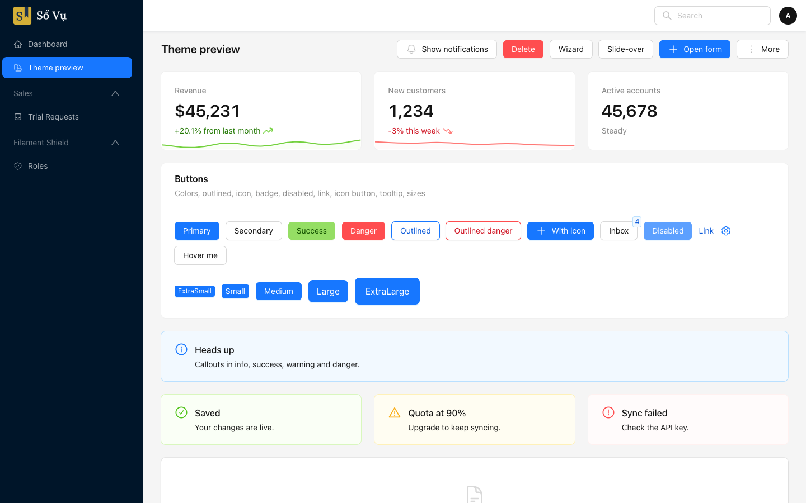 | 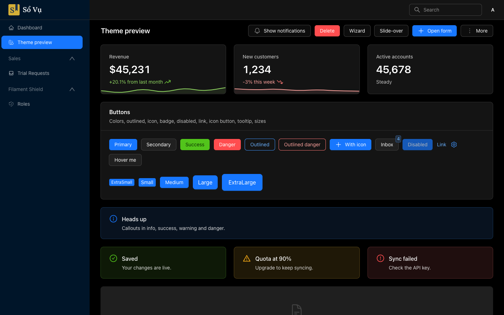 |

<details>
<summary>Thêm: đăng nhập, modal, thông báo, mobile, toàn trang</summary>

| | Sáng | Tối |
|---|---|---|
| Đăng nhập | 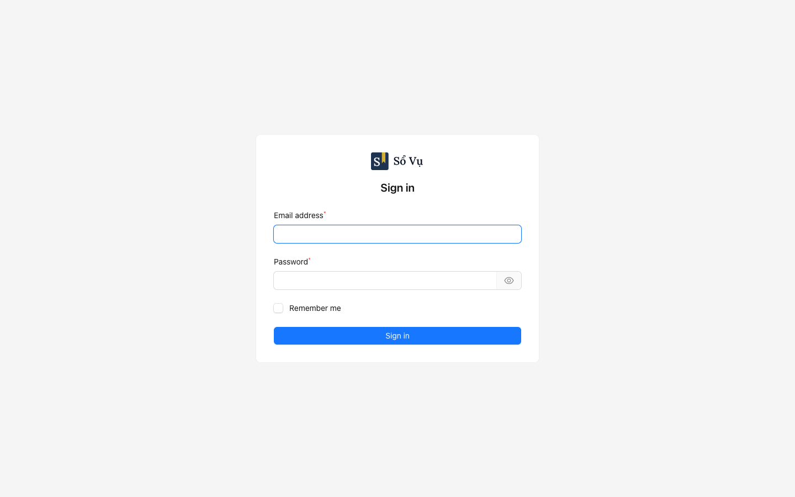 | 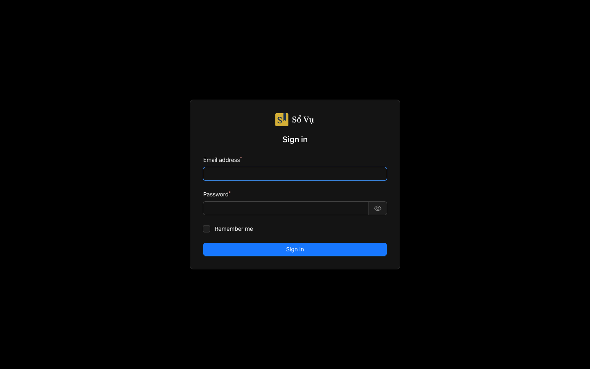 |
| Modal form | 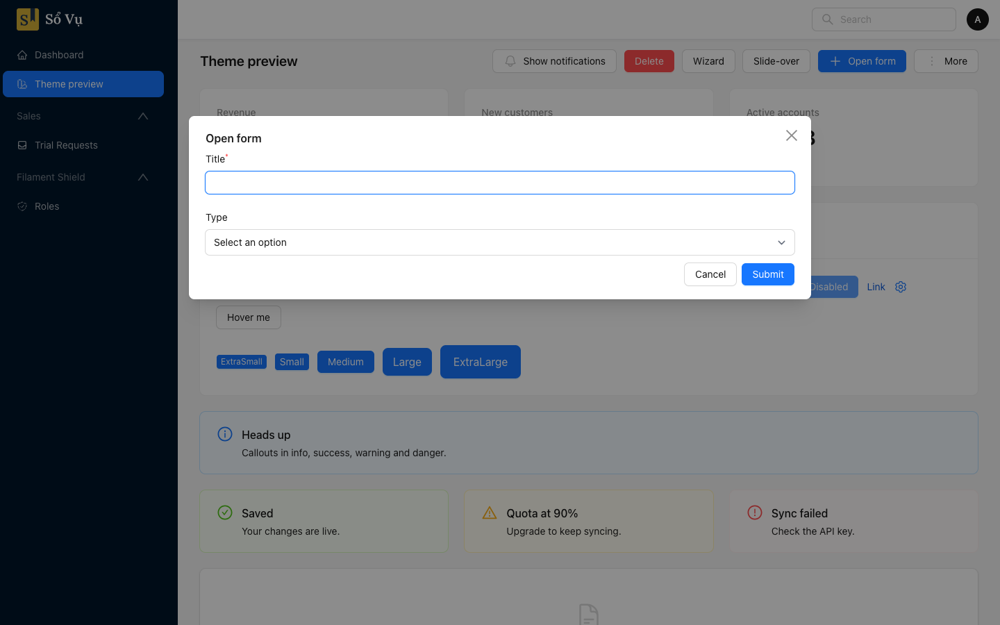 | 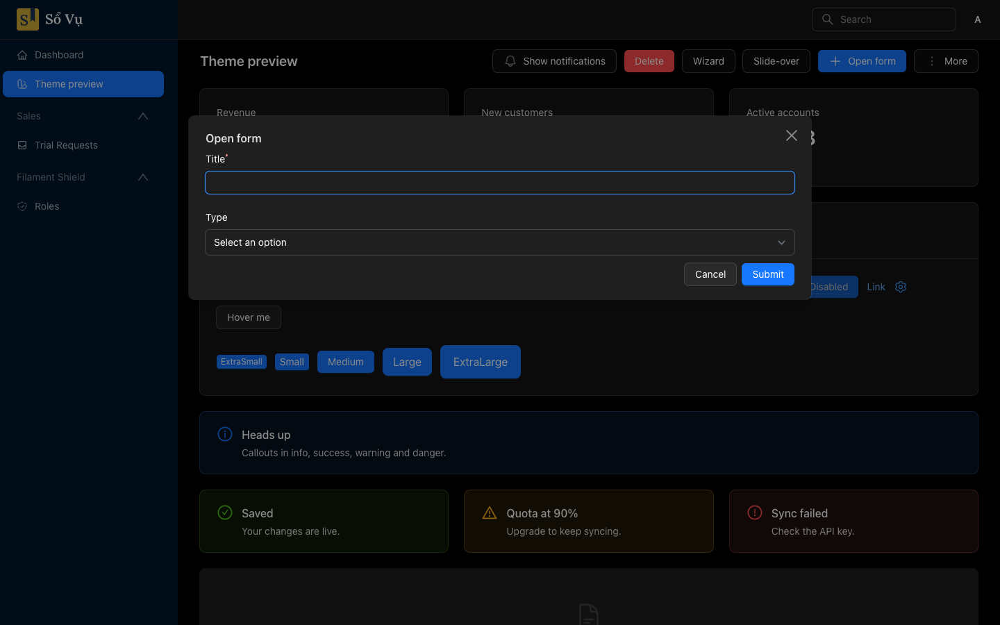 |
| Hộp thoại xác nhận | 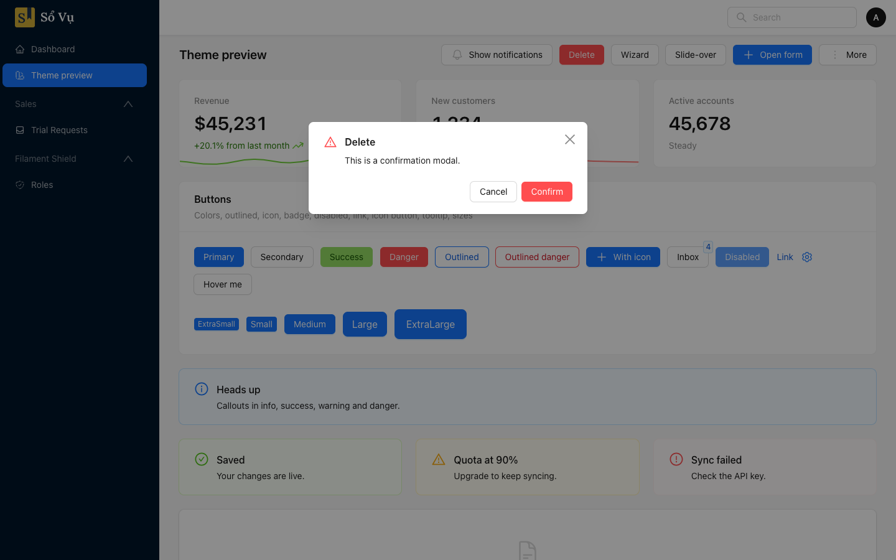 | 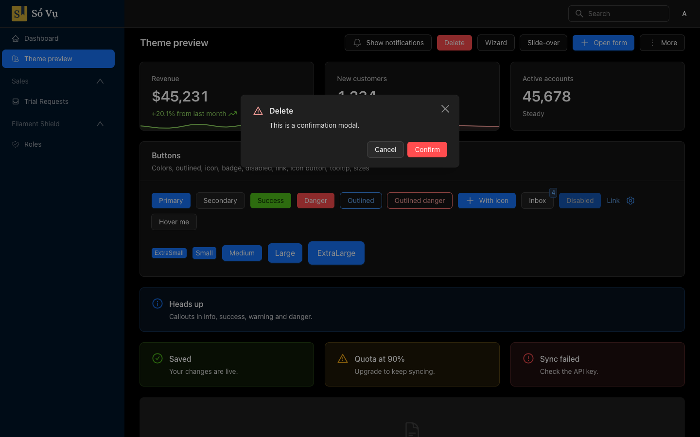 |
| Wizard | 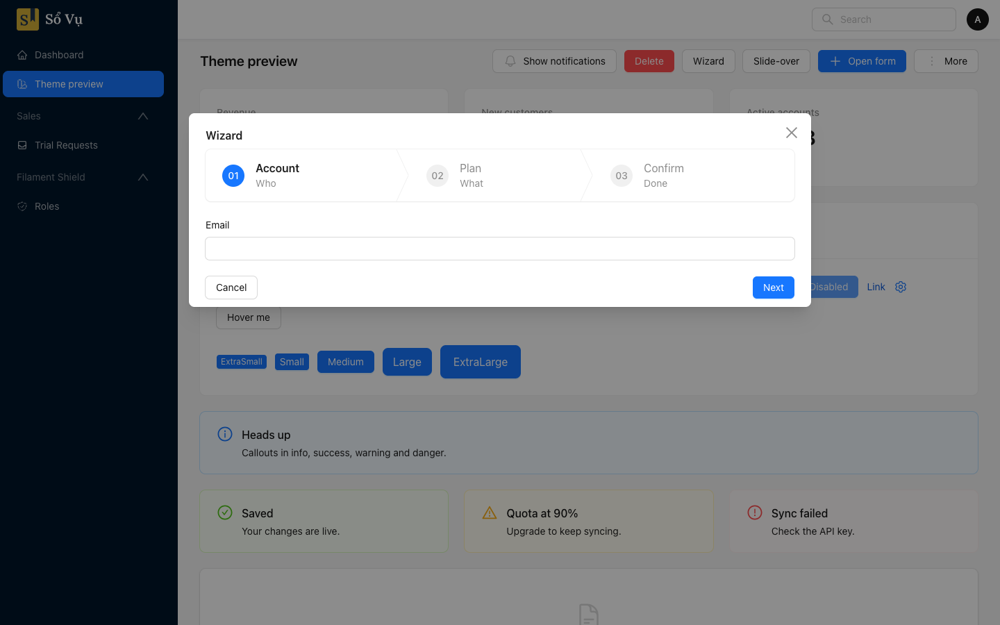 | 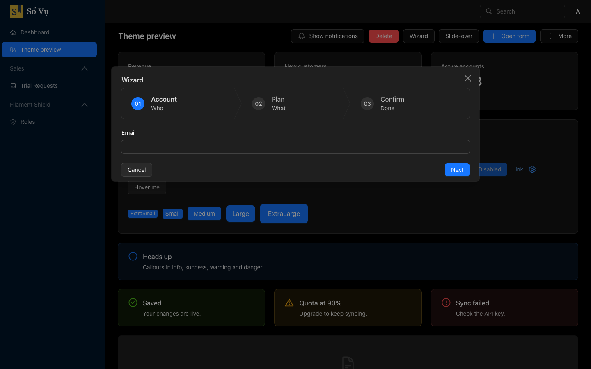 |
| Slide-over | 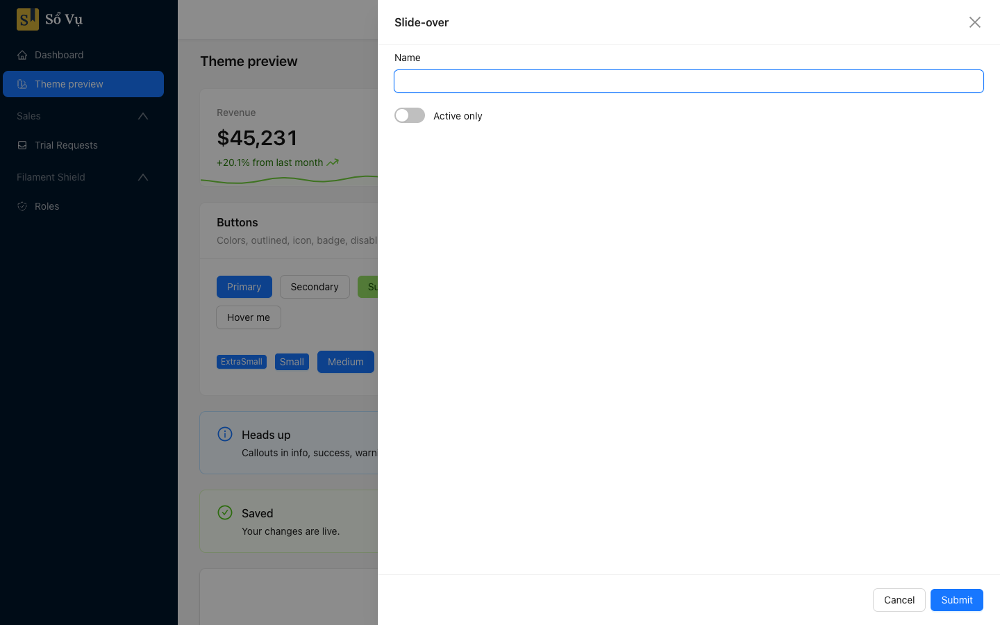 | 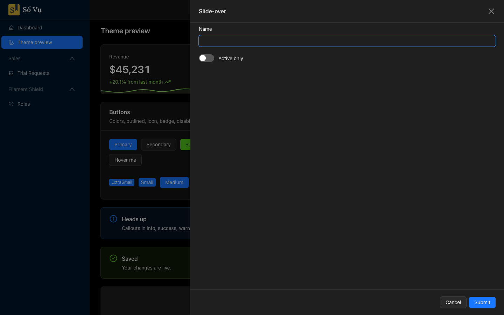 |
| Thông báo | 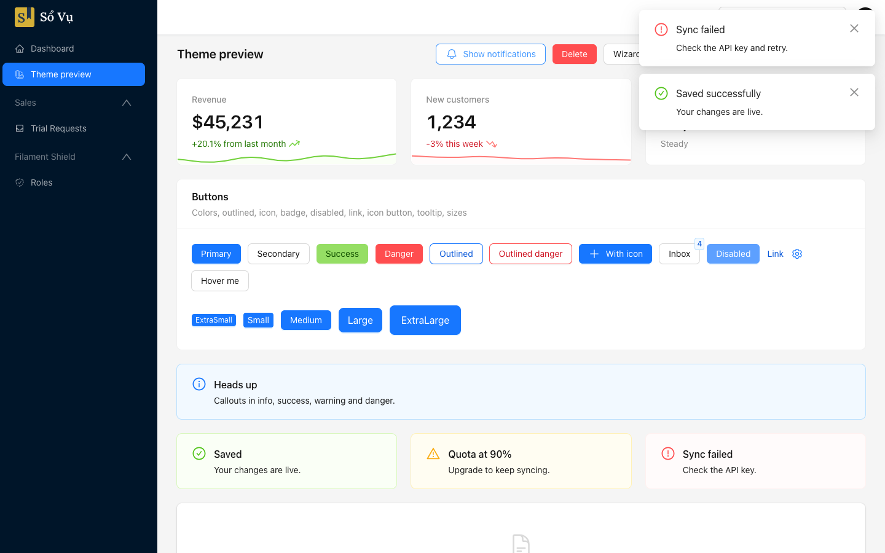 | 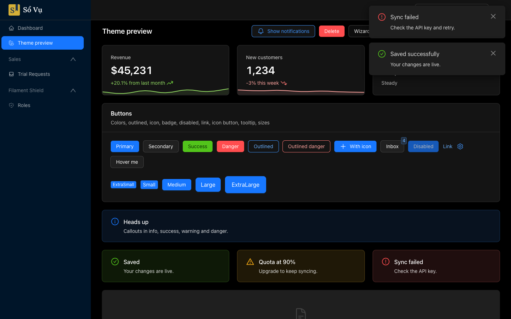 |
| Mobile | 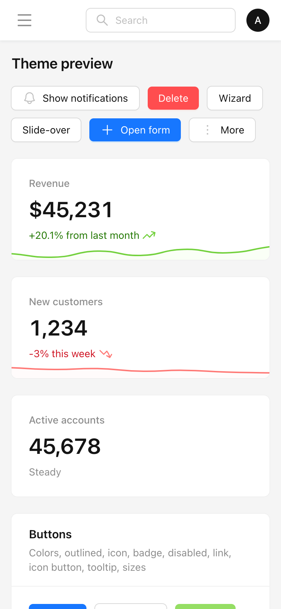 | 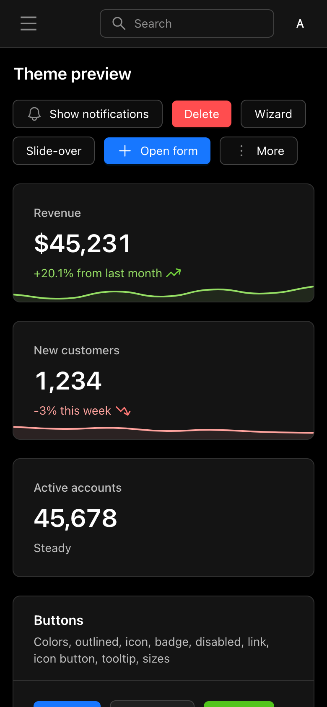 |
| Toàn trang | 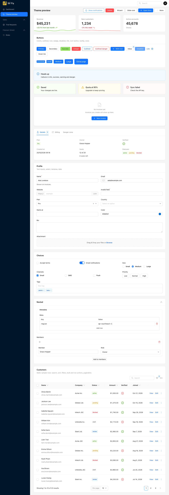 | 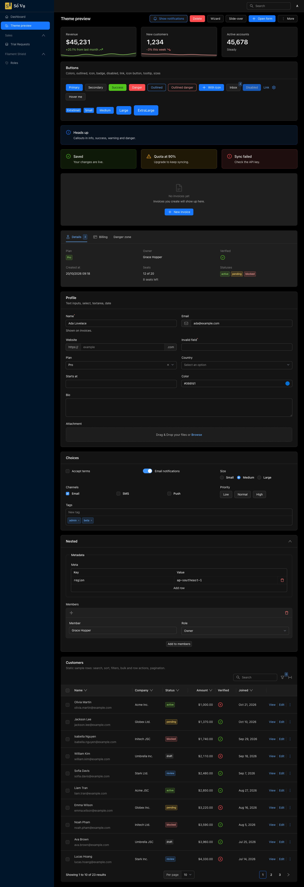 |

</details>

## Yêu cầu

- PHP 8.3+
- Laravel 12 hoặc 13
- Filament 5

## Cài đặt

**1. Cài package**

```bash
composer require field-vn/filament-themes:^0.1
```

> [!NOTE]
> Hiện chưa có phiên bản nào được tag. Trước khi phát hành `v0.1.0`, hãy cài từ nhánh development:
> `composer require field-vn/filament-themes:dev-development`.

**2. (Tùy chọn) Cài bộ icon của preset**

Chỉ cần khi bật `->icons()`. Ba bộ icon nặng tổng cộng khoảng 40 MB nên package không tự cài. Chỉ cài bộ của preset
bạn dùng:

```bash
composer require secondnetwork/blade-tabler-icons   # Preset::Tabler
composer require mallardduck/blade-lucide-icons     # Preset::Shadcn
composer require codeat3/blade-ant-design-icons     # Preset::Antd
```

**3. Publish CSS**

```bash
php artisan filament:assets
```

Lệnh này chép stylesheet ra `public/css/field-vn/filament-themes/`. Dự án Filament chuẩn đã chạy `filament:upgrade` trong
script `post-autoload-dump` nên bước này diễn ra tự động. Nếu dự án của bạn không có, hãy chạy tay sau mỗi lần cập nhật
package, và thêm lệnh này vào bước build image Docker.

<details>
<summary>Cài từ repository private</summary>

Nếu package chưa có trên Packagist (hoặc repository để private), khai báo repository trong `composer.json` của dự án
trước khi chạy `composer require`:

```json
"repositories": [
    { "type": "vcs", "url": "https://github.com/field-vn/filament-themes" }
]
```

Với repository private, máy build (Docker, CI) cần token GitHub, ví dụ qua biến môi trường `COMPOSER_AUTH`.

</details>

## Sử dụng

Đăng ký plugin trong panel provider:

```php
use FieldVn\FilamentThemes\FilamentThemes;
use FieldVn\FilamentThemes\Preset;

public function panel(Panel $panel): Panel
{
    return $panel
        // ...
        ->brandLogo(asset('images/logo.svg'))
        ->darkModeBrandLogo(asset('images/logo-white.svg')) // dùng cho dark mode và sidebar tối
        ->plugin(
            FilamentThemes::make()
                ->preset(Preset::Shadcn)
                ->icons()
                ->previewPage(! app()->isProduction()),
        );
}
```

### Tùy chọn

| Phương thức | Mặc định | Mô tả |
|---|---|---|
| `->preset(Preset::Tabler)` | `Tabler` | Design system: `Preset::Tabler`, `Preset::Shadcn` hoặc `Preset::Antd`. Dùng chuỗi (`'shadcn'`) cũng được. |
| `->icons()` | tắt | Thay Heroicons của Filament bằng bộ icon của preset. Cần cài package icon (xem [Icon](#icon)). |
| `->horizontal()` | tắt | Dùng header trắng 2 hàng (menu trên cùng) thay cho sidebar. |
| `->darkSidebar()` | bật với Antd | Sidebar tối (chỉ bố cục dọc). Truyền màu để dùng màu thương hiệu: `->darkSidebar('#1D334F')`. Truyền `false` để tắt. |
| `->alignModals(false)` | bật | Giữ cách căn modal của Filament thay vì theo design system. |
| `->previewPage()` | tắt | Thêm trang "Theme preview". Không bật trên production. |

### Bố cục

Mỗi preset tự đặt bố cục khi plugin được đăng ký:

| | Tabler | shadcn | Ant Design |
|---|---|---|---|
| `topbar()` | tắt | tắt | bật |
| `sidebarWidth()` | mặc định của Filament | 16rem | 16rem |

Muốn thay đổi, gọi `->topbar()` hoặc `->sidebarWidth()` trên panel **sau** `->plugin()`.

### Trang xem trước

`->previewPage()` thêm trang `/{panel}/theme-preview`, hiển thị gần đủ component thường gặp trên dữ liệu mẫu:

- nút đủ màu và kích cỡ, link, icon button, tooltip
- thẻ số liệu, callout, empty state, tab, infolist
- form với mọi loại trường, kể cả upload file
- bảng có tìm kiếm, sắp xếp, lọc, bulk action và phân trang (tìm một chuỗi không tồn tại để xem trạng thái rỗng)
- modal form, hộp xác nhận, wizard, slide-over, dropdown, thông báo

Dùng trang này để so sánh các preset hoặc kiểm tra lại giao diện sau khi nâng cấp Filament.

> [!NOTE]
> Nếu bạn cache component (`php artisan filament:optimize` hoặc `filament:cache-components`), trang này sẽ chưa có route
> cho tới khi chạy lại lệnh đó.

### Modal

Mặc định, modal theo bố cục của design system đang dùng (`Preset::modalAlignment()`):

- Nút ở footer căn phải, nút chính nằm ngoài cùng.
- Modal căn giữa (hộp xác nhận và modal hẹp của Tabler) chia đều các nút theo chiều ngang.
- shadcn và Ant Design căn tiêu đề modal sang trái.

Action nào tự đặt `->modalAlignment()` hoặc `->modalFooterActionsAlignment()` thì giữ nguyên cách của nó. Muốn tắt hoàn
toàn, dùng `->alignModals(false)`.

Muốn đặt mặc định riêng cho mọi action, dùng `Action::configureUsing(..., isImportant: true)`. Nếu thiếu `isImportant`,
cấu hình của bạn chạy trước plugin và sẽ bị ghi đè.

## Màu sắc

Nếu không gọi `->colors()`, plugin dùng bảng màu của preset. Plugin chỉ điền những màu panel **chưa** đặt, nên
`->colors()` của bạn luôn được ưu tiên, dù gọi trước hay sau `->plugin()`.

| Preset | Bảng màu |
|---|---|
| Tabler | primary `#066fd1`, danger `#d63939`, warning `#f59f00`, success `#2fb344`, info `#4299e1`, gray = slate |
| shadcn | primary = thang neutral, gần đen `oklch(0.205 0 0)` ở sắc độ 600; gray = neutral. Ở dark mode, nút chính đảo thành xám sáng chữ đen. |
| Ant Design | 10 sắc chính thức của `@ant-design/colors` (blue, red, gold, green), màu token ở sắc độ 600 và màu hover ở 500; gray = neutral của antd. Nút primary và danger giữ chữ trắng. |

> [!WARNING]
> `#1677ff` của Ant Design trên nền trắng chỉ đạt độ tương phản 3.97:1, thấp hơn ngưỡng 4.5:1 mà Filament áp dụng. Nếu cần
> đạt WCAG AA, dùng `'primary' => Palette::anchored('#0958d9', 600)`.

### Giữ đúng màu thương hiệu

`Color::hex()` của Filament chỉ giữ hue, nên màu thương hiệu không bao giờ hiện đúng mã. Hãy dùng `Palette`:

```php
use FieldVn\FilamentThemes\Support\Palette;

->colors([
    // Sinh thang màu với đúng màu này ở sắc độ 600 (dùng cho nút)
    'primary' => Palette::anchored('#0054a6', 600),

    // Hoặc truyền sẵn thang đủ 11 sắc (50–950)
    'info' => Palette::fromShades([50 => '#e6f4ff', /* … */ 950 => '#001d66']),
])
```

## Icon

`->icons()` thay toàn bộ icon alias của Filament bằng bộ icon của preset (bảng ánh xạ nằm trong `src/Presets/*/Icons.php`):

| Preset | Bộ icon | Package | Tiền tố cho icon của bạn |
|---|---|---|---|
| Tabler | Tabler Icons | `secondnetwork/blade-tabler-icons` | `tabler-…` |
| shadcn | Lucide | `mallardduck/blade-lucide-icons` | `lucide-…` |
| Ant Design | Ant Design Icons | `codeat3/blade-ant-design-icons` | `antdesign-…-o` |

- Các package icon chỉ là gợi ý (`suggest`), không bắt buộc. Nếu bật `->icons()` mà chưa cài đúng package, plugin báo lỗi
  kèm lệnh `composer require` cần chạy.
- Icon do bạn tự đặt (ví dụ icon menu của resource) được giữ nguyên. Dùng tiền tố ở bảng trên cho khớp preset.
- Ant Design không có icon mặt trời/mặt trăng, nên nút chuyển sáng/tối giữ Heroicons của Filament.

Trên production, chạy `php artisan icons:cache` (hoặc `filament:optimize`) để không phải quét bộ icon ở mỗi request.

## Logo

- Sidebar sáng và header ngang dùng `->brandLogo()`.
- Sidebar tối (`->darkSidebar()`, hoặc mặc định của Ant Design) dùng `->darkModeBrandLogo()`. Nếu logo là ảnh chữ tối,
  hãy thêm bản logo sáng qua `->darkModeBrandLogo()`.
- Logo dạng chữ (tên thương hiệu) tự đổi sang màu trắng.

## Tùy biến bằng biến CSS

Mọi giá trị đều lấy từ biến CSS `--ft-*` do preset đặt, cho light mode, `.dark`, và `html[data-ft-sidebar="dark"]`. Ghi đè
trong theme Vite riêng, hoặc qua render hook `STYLES_AFTER` (đăng ký **sau** plugin):

```css
:root {
    --ft-sidebar-accent: #d4af37; /* vạch đánh dấu mục đang chọn (sidebar tối của Tabler) */
    --ft-table-cell-py: 0.5rem;   /* dòng bảng thoáng hơn */
}
```

| Nhóm | Biến |
|---|---|
| Nền, viền, bóng | `--ft-body-bg`, `--ft-surface`, `--ft-surface-secondary`, `--ft-border`, `--ft-border-input`, `--ft-shadow-card/input/overlay` |
| Focus | `--ft-focus-border`, `--ft-focus-ring`, `--ft-focus-width` |
| Chữ | `--ft-font-family`, `--ft-heading-size/weight/…`, `--ft-label-size/weight/transform/…` (nhãn nhỏ: nhóm menu, breadcrumb, stat) |
| Khoảng cách | `--ft-topbar-height`, `--ft-page-gap`, `--ft-field-gap`, `--ft-card-padding`, `--ft-card-header-padding`, `--ft-table-cell-py` |
| Bảng | `--ft-table-head-bg/color/size/weight/transform`, `--ft-table-row-hover` |
| Control | `--ft-btn-padding/weight/line-height`, `--ft-switch-width/height/knob/shift/off-bg`, `--ft-upload-bg` |
| Overlay | `--ft-overlay` (nền mờ sau modal), `--ft-tooltip-bg/text/size/padding/radius` |
| Sidebar | `--ft-sidebar-bg/text/text-muted/text-active/hover-bg/active-bg/divider/accent`, `--ft-nav-item-padding/radius` |
| Header ngang | `--ft-navbar-height`; `--ft-container` theo `->maxContentWidth()` |
| Bo góc | `--radius-sm/md/lg/xl` (Tabler 4/4/6/8px, shadcn tính từ `--radius: 0.625rem`, Antd 4/4/6/8px) |

## Chi tiết từng component

Cách mỗi component được tạo kiểu theo từng preset.

### Bảng

| Tabler | shadcn (theo `examples/tasks`) | Ant Design (theo ProTable) |
|---|---|---|
| Nằm trong card phẳng. Tiêu đề cột 12px/500 chữ hoa trên nền xám nhạt. Chữ ô xám đậm. Action là link chữ, không icon. | Không card, chỉ có viền bo 8px. Ô tìm kiếm cao 32px ở trên bên trái, nút lọc viền nét đứt. Tiêu đề cột không nền, dòng thấp, phân trang ở dưới. | Card trắng không viền. Tiêu đề cột nền `#fafafa` có vạch ngăn, ô padding 16px. Thanh chọn hàng là Alert xanh. Action là link ngăn bằng vạch ("View \| Edit"). |

### Component khác

| Component | Tabler | shadcn | Ant Design |
|---|---|---|---|
| Nút, input | Cao 40px (sm 32, lg 48, xl 56); nút màu có viền tối và highlight phía trên | Cao 36px, px-4 (sm 32, lg 40) | Cao 32px (sm 24, lg 40), chữ đậm 400; nút trắng chuyển xanh khi hover |
| Modal | Header 56px kẻ dưới; footer nền xám nhạt kẻ trên; nút Hủy sát trái | Bo 10px, padding 24px, tiêu đề 18px, nút cách nhau 8px | Padding 20px 24px, tiêu đề 16px, nền mờ 45% |
| Hộp xác nhận | Vạch màu 2px trên cùng, icon lớn, nút chiếm hết chiều ngang | AlertDialog: icon trong ô vuông bo góc nền nhạt cạnh tiêu đề, nút bên phải | Modal.confirm: icon 22px trước tiêu đề, nội dung thụt theo tiêu đề, nút bên phải |
| Thông báo | Toast bo 6px, bóng nhẹ | Sonner: chữ 13px, icon 16px, cùng một card trắng cho mọi loại | Notification: tiêu đề 16px, padding 20px 24px, không viền |
| Tooltip | Nền tối 90%, chữ 12px | Nền đen, chữ 12px, bo 8px | Nền đen 85%, chữ 14px |
| Switch | 32×20 | 32×18 | 44×22 |
| Checkbox | 20px, bo 6px | 16px | 16px |
| Dropdown | Mục chiếm hết chiều ngang, không bo | Mục px-2 py-1.5, icon 16px | Mục 5px 12px; mục xóa chuyển đỏ khi hover |
| Empty state | Icon lớn, tiêu đề 20px | Khung nét đứt, icon trong ô vuông xám | Icon xám nhạt, chữ "No data" màu phụ |
| ToggleButtons | Đang chọn: viền và chữ màu trên nền nhuộm nhẹ | Đang chọn: nền `accent` xám | Đang chọn: nền trắng, viền và chữ xanh (Radio.Button) |
| Upload file | Khung nét đứt | Khung nét đứt | Khung nét đứt nền `#fafafa`, bo 8px (Upload.Dragger) |
| Wizard | Như Filament | Như Filament | Steps: vòng tròn 32px, bước hiện tại màu xanh, bước đã xong xanh nhạt |

## Cách hoạt động

- **Cấu trúc chung + token theo preset.** `resources/dist/core.css` chứa các selector `fi-*` cần ghi đè và chỉ đọc biến
  `--ft-*`. Mỗi file preset (`tabler.css`, `shadcn.css`, `antd.css`) định nghĩa đủ các biến đó và thêm vài rule riêng
  (ví dụ card inset của shadcn hay vạch ngăn cột của antd). Trang chỉ nạp `core.css` và file của preset đang dùng.
- **Nạp sau theme của panel.** CSS nằm trong `@layer components` và được chèn qua render hook `STYLES_AFTER`. Selector
  chép từ CSS gốc của Filament, nên ghi đè được mà utility class vẫn thắng như bình thường. Màu nút (Filament đặt bằng
  utility `fi-bg-color-*`) được ghi đè trong `@layer utilities`.
- **Tên file an toàn với cache.** File publish có hash nội dung trong tên (`core-<hash>.css`) thay vì query string `?v=`,
  vì CDN cấu hình bỏ qua query string (như "Ignore query string" của Cloudflare) sẽ tiếp tục trả CSS cũ.
- **Không lấn cấu hình của dự án.** Màu, icon và font được áp trong `boot()` của plugin, sau khi panel đăng ký cấu hình
  của nó, và chỉ cho những gì panel chưa đặt.

## Nâng cấp Filament

Nếu Filament đổi class hoặc markup, phần bị ảnh hưởng sẽ quay về style mặc định của Filament. Trang không bị vỡ. Sau mỗi
lần nâng cấp Filament:

1. Chạy `composer test` trong repository này (CI cũng chạy ở mỗi lần push, với Filament mới nhất). Test kiểm tra:
   - cả ba bộ icon vẫn phủ đủ alias của Filament, và mọi icon đều tồn tại
   - mọi biến dùng trong `core.css` đều được cả ba preset định nghĩa
   - CSS vẫn nạp sau theme của panel
   - màu nút primary của Tabler vẫn đúng
   - trang xem trước và các modal của nó vẫn mở được
2. Chạy `git diff` trên `vendor/filament/*/resources/css` giữa hai phiên bản, rồi sửa selector tương ứng trong `core.css`
   và các file preset.
3. Mở trang xem trước với từng preset ở light và dark mode, bố cục dọc và ngang, và trên mobile.

## Nâng cấp từ filament-tabler-theme

Package này trước đây tên là `field-vn/filament-tabler-theme`. Tabler vẫn là preset mặc định nên giao diện không đổi.

1. Thay package:

   ```bash
   composer remove field-vn/filament-tabler-theme
   composer require field-vn/filament-themes:^0.1
   ```

2. Đổi tên trong code:

   | Trước | Sau |
   |---|---|
   | `TablerTheme::make()` | `FilamentThemes::make()` (`FieldVn\FilamentThemes\FilamentThemes`) |
   | `->tablerIcons()` | `->icons()` |
   | Biến CSS `--tabler-*` | `--ft-*` |
   | `[data-tabler-sidebar]` | `[data-ft-sidebar]` |

3. Nếu dùng `->icons()`, cài `secondnetwork/blade-tabler-icons`. Package không còn tự cài bộ icon này.
4. Chạy `php artisan filament:assets`, rồi xóa thư mục CSS của package cũ trong `public/css/field-vn/`.

## Giới hạn

- Không thay đổi HTML của Filament (không publish view), nên những thiết kế cần markup khác không làm được, ví dụ logo
  nằm ngoài card ở trang đăng nhập (Tabler) hay header trang nằm trong card inset (shadcn).
- Hỗ trợ sidebar thu gọn (`sidebarCollapsibleOnDesktop`), nhưng khi thu gọn thì logo nằm trên nền trắng của topbar
  (Ant Design, hoặc khi bật topbar).
- shadcn tải font Geist từ Bunny Fonts (`fonts.bunny.net`). Muốn tự host, đặt `->font()` cho panel.
- Tooltip được tạo kiểu qua `.tippy-box[data-theme]`, nên mọi popup tippy.js trong trang, kể cả của plugin khác (ví dụ
  menu của editor tiptap), cũng chuyển sang kiểu nền tối.

## Phát triển

```bash
composer install   # đồng thời chạy `testbench package:discover`
composer ci        # pint --test, phpstan (level 7), pest
composer format    # pint
```

Test chạy trên [Orchestra Testbench](https://packages.tools/testbench). `tests/Fixtures/AdminPanelProvider.php` là panel
`/admin` giống panel do `filament:install --panels` sinh ra, có thêm plugin (`->icons()->previewPage()`). Cả ba bộ icon
nằm trong `require-dev` để test phủ đủ mọi preset. CI chạy trên PHP 8.3/8.4/8.5 × Laravel 12/13 với Filament mới nhất,
cùng một lượt với phiên bản dependency thấp nhất mà `composer.json` cho phép.

Phát hành: cập nhật `CHANGELOG.md`, merge `development` vào `main`, rồi tag `vX.Y.Z` trên `main`.

## Giấy phép

MIT. Phát triển bởi [field.vn](https://field.vn/).

Ngôn ngữ thiết kế theo Tabler, shadcn/ui và Ant Design (đều MIT). Icon từ Tabler Icons (MIT), Lucide (ISC) và Ant Design
Icons (MIT). Xem [`NOTICE`](NOTICE) để biết chi tiết.

## Ghi nhận

Gói này không thể có nếu không có công sức của các design system dưới đây và tác giả của chúng. Toàn bộ công lao về ngôn
ngữ thiết kế thuộc về họ:

- **[Tabler](https://tabler.io)** ([GitHub](https://github.com/tabler/tabler)) của Paweł Kuna và The Tabler Authors, MIT
- **[shadcn/ui](https://ui.shadcn.com)** ([GitHub](https://github.com/shadcn-ui/ui)) của shadcn, MIT
- **[Ant Design](https://ant.design)** ([GitHub](https://github.com/ant-design/ant-design)) của Ant UED, MIT

Icon: [Tabler Icons](https://tabler.io/icons) (MIT), [Lucide](https://lucide.dev) (ISC),
[Ant Design Icons](https://ant.design/components/icon) (MIT). Font: [Geist](https://vercel.com/font) (SIL OFL 1.1),
tải từ Bunny Fonts.

Dự án này không liên kết, không được tài trợ hay bảo trợ bởi Tabler, shadcn hoặc Ant Group. Tabler, shadcn/ui và Ant Design
là thương hiệu của chủ sở hữu tương ứng, chỉ được nhắc đến để mô tả preset nào theo design system nào.
